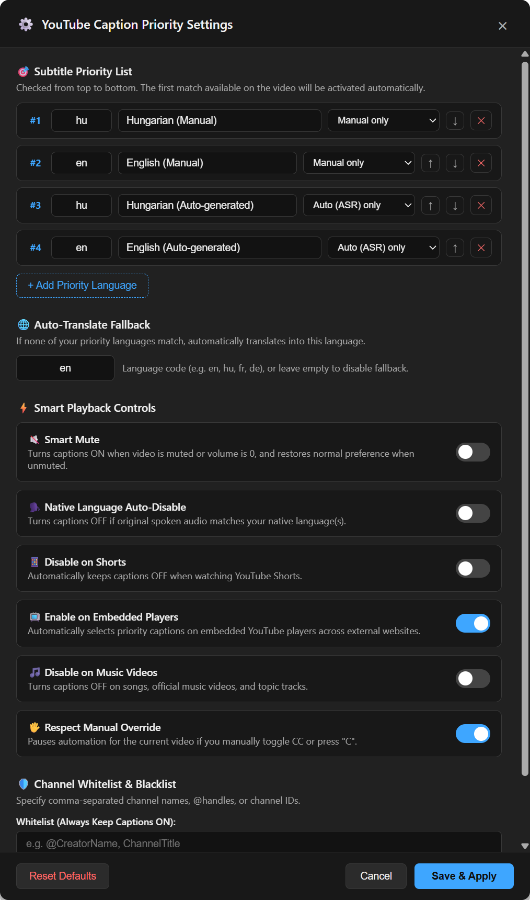
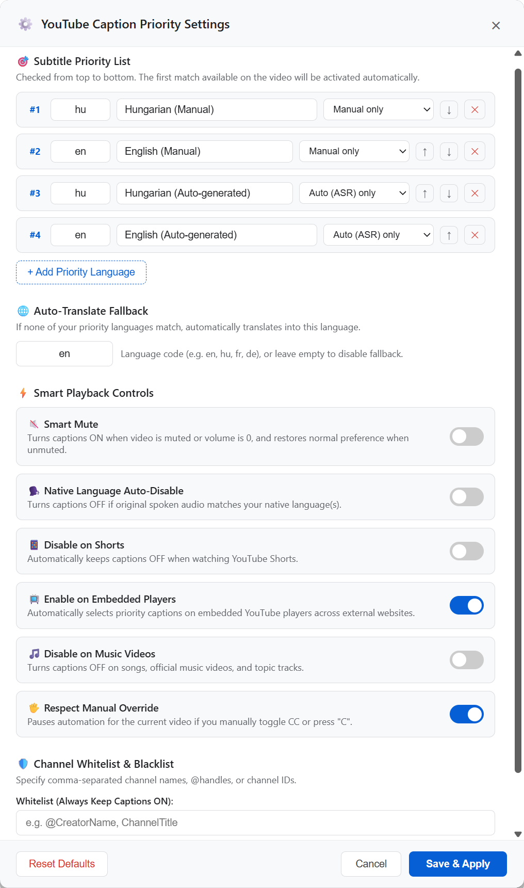

# 🎬 YouTube Priority Caption Selector

An intelligent, lightweight userscript for YouTube that automatically chooses and activates subtitle tracks based on your personal ordered priority list. If none of your preferred languages are directly available, it can automatically translate into your target language.

Includes a full in-page visual settings dashboard accessible right from your userscript menu, with full support for Light/Dark themes and Fullscreen mode!

---

### 📸 Screenshots

| Dark Mode | Light Mode |
| :---: | :---: |
|  |  |

---

### ✨ Key Features

* 🔢 **Multi-Level Priority Rules:** Set up an ordered list of preferred subtitle languages (e.g., Hungarian Manual → English Manual → Hungarian Auto → English Auto). The script evaluates them in order and activates the first available match.
* ✍️ **Manual vs. ASR Distinction:** Differentiate between human-crafted subtitles and YouTube's automatic speech recognition (ASR) tracks.
* 🌐 **Intelligent Auto-Translate Fallback:** When none of your preferred languages exist on the video, it selects the best available source track and requests YouTube's auto-translation into your chosen fallback language.
* 🔇 **Smart Mute:** Automatically enables captions whenever the player is muted or volume is set to 0%, and cleanly restores your preference when unmuted.
* 🗣️ **Native Audio Auto-Disable:** Automatically suppresses subtitles if the video's original spoken audio is in your native language.
* 🎧 **Multi-Language Audio Track Awareness:** Automatically re-evaluates subtitle preferences when switching audio tracks on multi-language dubbed videos (e.g. switching between native and foreign audio dubs).
* 📺 **Channel Whitelists & Blacklists:** Force captions always ON or always OFF for specific creators/channels (supports `@handles`, channel IDs, and channel names).
* 🎵 **Shorts & Music Video Controls:** Optionally disable caption automation on official music videos, topic tracks, or YouTube Shorts.
* 🖥️ **Fullscreen Modal Visibility:** The Settings dashboard works seamlessly in Fullscreen mode—mounting directly on top of the player without exiting fullscreen.
* 🖱️ **Respects Manual Overrides:** If you manually click the CC button or change tracks in YouTube's player menu, the script steps aside for that video.
* ⚙️ **In-Page Settings GUI:** Configure all priority rules, options, and channel filters without touching any code.
* 🌓 **Auto Theme Support:** The settings interface automatically adapts to YouTube’s active Light or Dark appearance without OS conflicts.
* ⚡ **Flicker-Free & Edge-Case Resilient:** Hooks directly into YouTube's player API and browser history cache (bfcache), cleanly handling Miniplayer, playlist embeds, channel trailers, pre-roll ads, and upcoming Premieres with zero player reload flickers.

---

### ⚙️ How to Configure

1. Open any video on [YouTube](https://www.youtube.com).
2. Click your **Tampermonkey** or **Violentmonkey** extension icon in your browser toolbar.
3. Click **`⚙️ Edit Caption Settings`**:
   * Drag or reorder rules with the **↑** and **↓** buttons.
   * Add or remove language codes.
   * Toggle **Smart Mute**, **Native Language Auto-Disable**, **Shorts**, and **Music** switches.
   * Add channel names or `@handles` to the whitelist/blacklist.
   * Click **Save & Apply** to reload with your new preferences.

*(Your settings are saved permanently via `GM_getValue`, so future script updates will never overwrite your custom configuration!)*

---

### 🛡️ Privacy & Security

* **100% Local Execution:** Operates entirely inside your browser tab without making any external network requests or tracking analytics.
* **CSP & Trusted Types Compliant:** Completely free of `innerHTML` assignments to comply with YouTube’s strict Content Security Policy.
* **Zero Data Collection:** Does not monitor, store, or transmit your watch history, search queries, or Google account credentials.

---

### 🔗 Links & Source Code

* **GitHub Repository:** [andris155/YouTubePriorityCaptionSelector](https://github.com/andris155/YouTubePriorityCaptionSelector)
* **Bug Reports & Feature Requests:** [GitHub Issues](https://github.com/andris155/YouTubePriorityCaptionSelector/issues)
* **License:** [MIT License](https://opensource.org/licenses/MIT)
